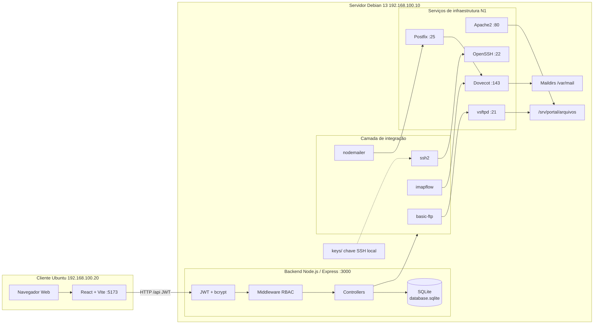
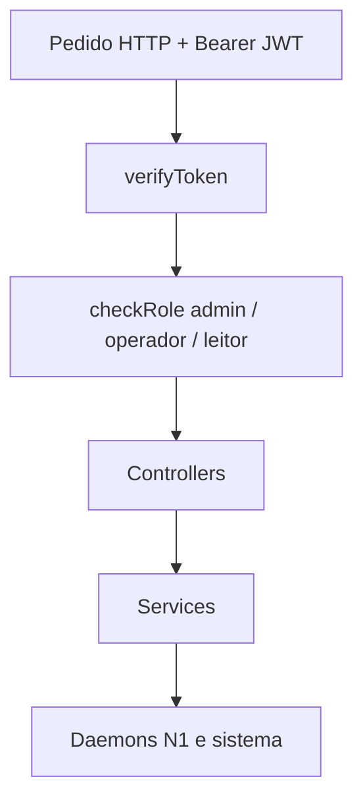
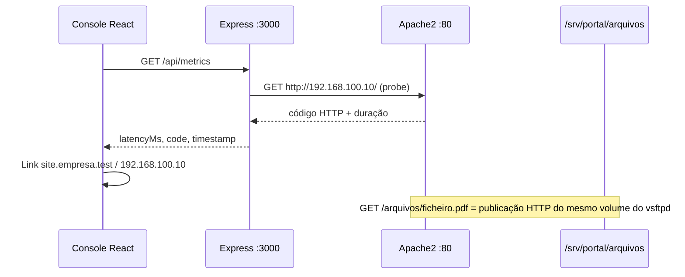
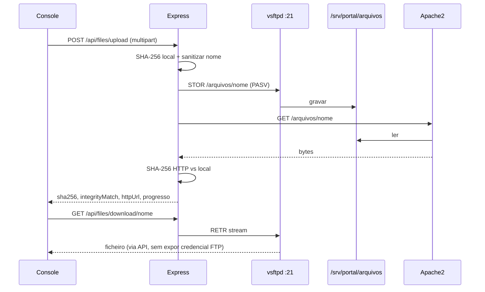
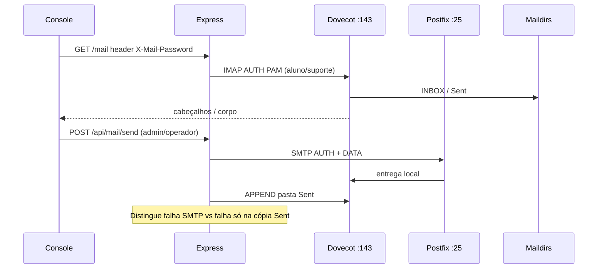
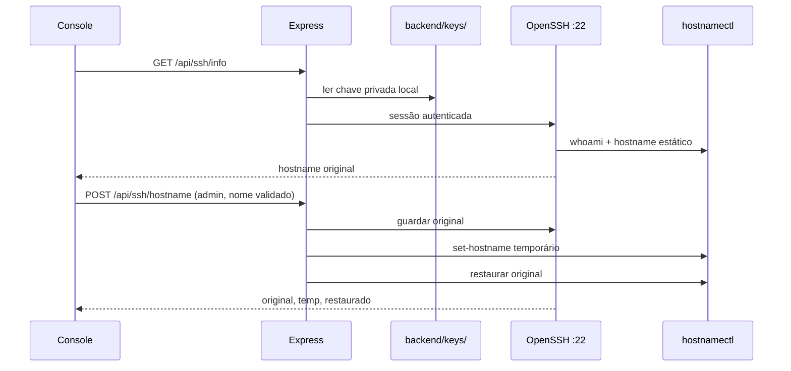
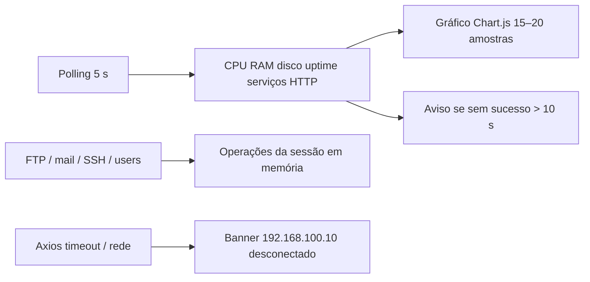

# Diagrama de Arquitetura — Console Integrado N2 (Parte 1)

Documento de apoio ao **item 4 da Seção 8.1** da especificação da Parte 1. Descreve a topologia da rede isolada `lab`, a separação de responsabilidades e os fluxos de dados entre o cliente Ubuntu, a API no Debian e os serviços da N1.

---

## 1. Visão geral em blocos

### Responsabilidades

| Componente | Máquina | Função |
| --- | --- | --- |
| Navegador + React/Vite (`:5173`) | Ubuntu `192.168.100.20` | Interface do console (abas por perfil, métricas, FTP, correio, SSH, logs) |
| Express (`:3000`) | Debian `192.168.100.10` | Autenticação JWT, RBAC, orquestração; **não** lê Maildirs nem a chave no browser |
| SQLite | Debian | Apenas utilizadores do console (não substitui IMAP nem o vsftpd) |
| Apache2 | Debian | Site `site.empresa.test` e publicação HTTP de `/srv/portal/arquivos` |
| vsftpd | Debian | Upload/listagem/download FTP para o mesmo diretório publicado |
| Postfix / Dovecot | Debian | SMTP e IMAP com autenticação PAM (`aluno`, `suporte`) |
| OpenSSH | Debian | Consulta e alteração reversível de hostname, com chave **só** em `backend/keys/` |

A rede interna VirtualBox `lab` isola o par `.10` / `.20`. O frontend chama `http://192.168.100.10:3000/api`.

---

## 2. Camadas da API (Debian)

| Rota (exemplos) | Quem executa | Destino |
| --- | --- | --- |
| `POST /api/auth/login` | Público | SQLite + bcrypt |
| `GET /api/metrics` | Qualquer autenticado | `systemctl`, CPU/RAM/disco, probe HTTP Apache |
| `POST /api/files/upload` | admin, operador | vsftpd → `/arquivos` |
| `GET /api/mail` | autenticado; senha no cabeçalho `X-Mail-Password` | Dovecot IMAP |
| `POST /api/mail/send` | admin, operador | Postfix SMTP + append Sent no IMAP |
| `POST /api/ssh/hostname` | admin | OpenSSH + `hostnamectl` |
| `GET /api/logs` | admin, operador | `journalctl` / `/var/log` |

O perfil `leitor` consulta métricas, FTP (leitura/download) e correio (leitura). Escrita de e-mail e upload FTP são recusadas no **backend** (403), não só na UI.

---

## 3. Fluxos de dados

### 3.1 HTTP / Apache

- A medição de latência é feita **no Debian** (API), identificada no painel (código, ms, instante `DD/MM/YYYY HH:mm:ss`).
- Ficheiros enviados por FTP tornam-se acessíveis em `http://site.empresa.test/arquivos/` sem `chmod 777`.

### 3.2 FTP e integridade SHA-256

- Nomes inválidos (`../`, caracteres fora de `[A-Za-z0-9._-]`) → **400**.
- Credenciais FTP vêm de `.env` (`FTP_HOST`, `FTP_USER`, `FTP_PASS`), não do browser.

### 3.3 Correio SMTP / IMAP

- A API **não** abre Maildirs como `www-data`; usa SMTP/IMAP com a conta PAM.
- Senha **não** via query string.

### 3.4 SSH reversível

- A chave (ex.: `id_ed25519_redes_n1`) **não** vai para o Git nem para a Web.
- O hostname é validado por expressão regular antes de qualquer comando.
- Não se exige `sudo` irrestrito no painel; a operação é limitada à alteração de nome.

---

## 4. Observabilidade e sessão (Parte 1)

A **Parte 2** (auditoria persistente, start/stop/restart, novos serviços) aparece só como marcação visual no menu e no dashboard, sem rotas de backend.

---

## 5. Ficheiros de referência no código

| Papel | Caminho |
| --- | --- |
| Entrada da API | `backend/src/index.js` |
| Ambiente | `backend/src/config/env.js`, `backend/.env.example` |
| RBAC | `backend/src/middleware/authMiddleware.js` |
| Métricas | `backend/src/services/metricsService.js` |
| FTP | `backend/src/services/ftpService.js` |
| Correio | `backend/src/services/mailService.js` |
| SSH | `backend/src/services/sshService.js` |
| UI / layout | `frontend/src/App.jsx` |
| Observabilidade | `frontend/src/components/DashboardView.jsx` |
